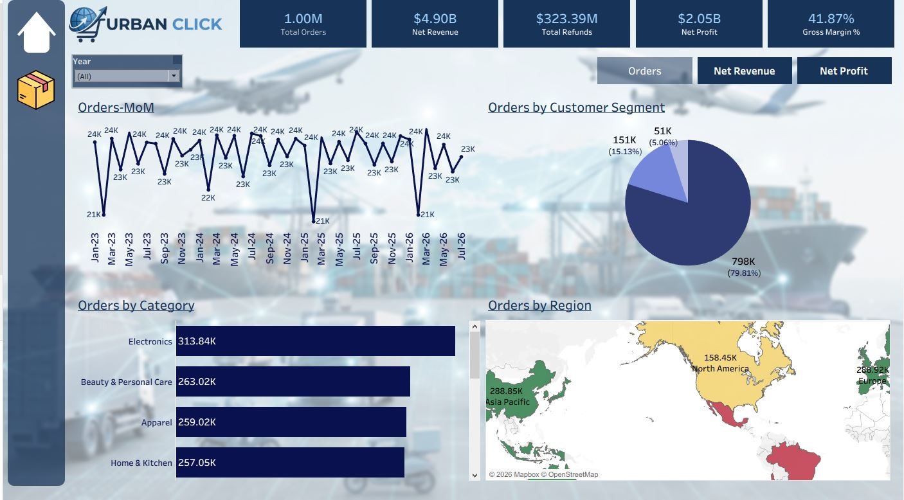
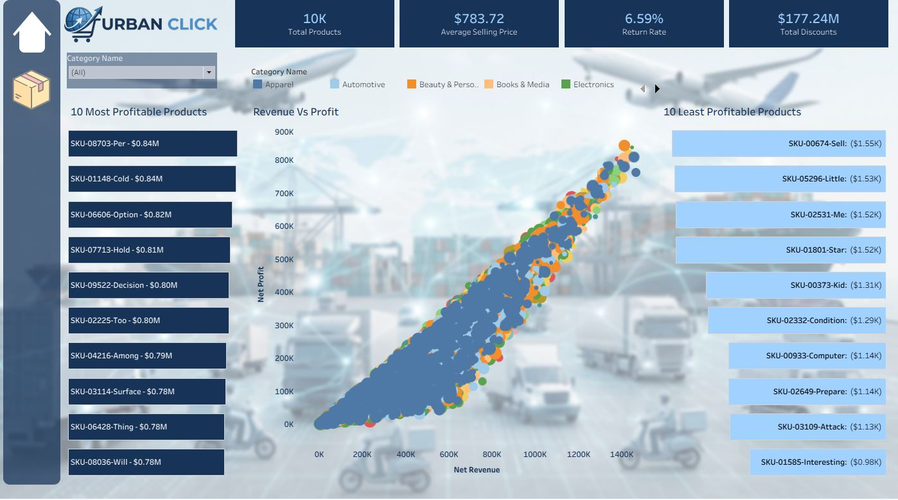
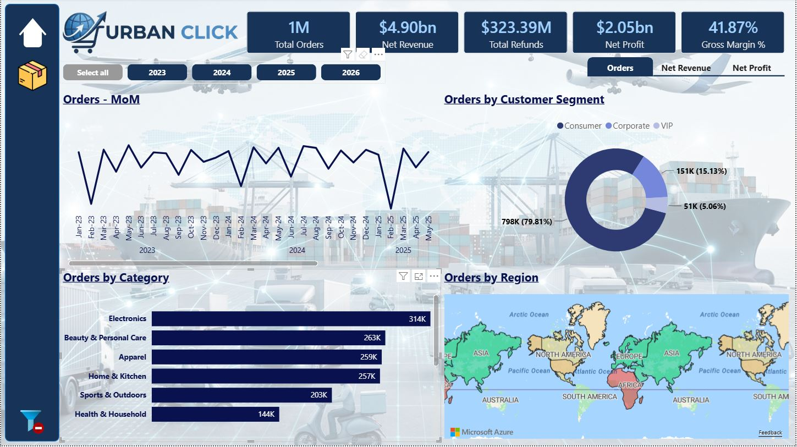
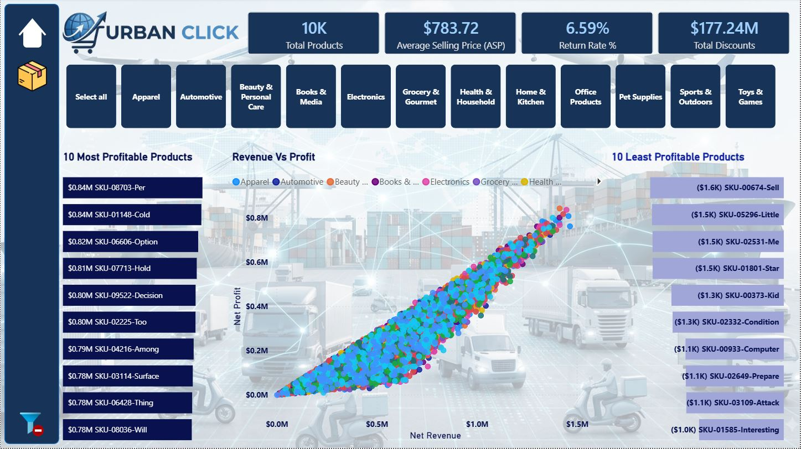

# Urbanclick Global Ecommerce Analysis
## Overview
This project is a production-style end-to-end data analysis that simulates a real enterprise Ecommerce business.

The Project Covers:
- Business Understanding & Schema Design
- Synthetic Dataset Generation
- Data Cleaning & Validation
- Exploratory Data Analysis (EDA)
- Business Analysis
- Star Schema Design
- Power BI Dashboard
- Tableau Dashboard
- Executive Business Report

## Project Phases
- Phase 1: Business Understanding & Schema Design ✅
- Phase 2: Synthetic Data Pipeline (Python) ✅
- Phase 3: Data Warehouse & MySQL Implementation ✅
- Phase 4: Exploratory Analytics in Tableau & Power BI: Executive Overview ✅
- Phase 5: Exploratory Analytics in Tableau & Power BI: Product Analysis ✅
- Phase 6: Exploratory Analytics in Tableau & Power BI: Customer Analysis 🔄
- Phase 7: Exploratory Analytics in Tableau & Power BI: Retruns and Logistics ⏳
- Phase 8: Enterprise Packaging & Git Commit Optimization ⏳

## Repository Structure
```text
data_pipeline/
docs/
power_bi/
reports/
sql/
tableau/
venv/
```

## Technology Stack
- MySQL
- Power BI
- Tableau
- Python (Data Generation)
- Git
- GitHub

## Documentation
- Business Requirement Document (BRD)
- ER_Diagram
- Metrics Catalog

## Portfolio link

### Tableau

[Tableau Public Dashboard](https://public.tableau.com/views/urbanclick_analytics_platform/NetProfit?\:language=en-US&\:sid=&\:redirect=auth&\:display_count=n&\:origin=viz_share_link)

##### How is the business performing? What are the major trends, customer segments, categories and regions by Order Volume, Revenue & Profit?



##### Which products and categories are profitable or unprofitable? What is the relationship between revenue and profit?




### Power BI

[Power BI Dashboard](https://app.powerbi.com/view?r=eyJrIjoiYjM4YjIwMTYtMjEzNy00NGFmLThjMmUtMTc5MDFiM2ZkMmI3IiwidCI6Ijk4NjNhOWJhLTczYTktNDZkZi04YzMzLTNkZDM3NTczNzk0ZSJ9)

##### How is the business performing? What are the major trends, customer segments, categories and regions by Order Volume, Revenue & Profit?



##### Which products and categories are profitable or unprofitable? What is the relationship between revenue and profit?



## Issues during project
1. **Connectivity between Power BI -> MySQL**\
    Compativility issue between native MySQL connector and the installed Connector/NET provider.

    **Solution:** Power BI was connected to MySQL using the MySQL ODBC 8.4 Unicode Driver. The database connection was validated through DSN testing before use.