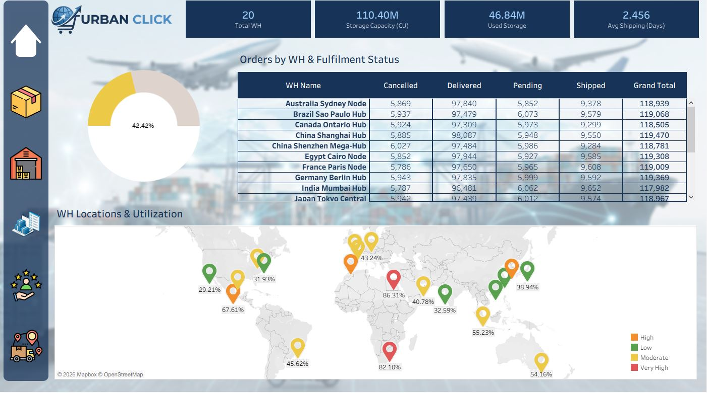
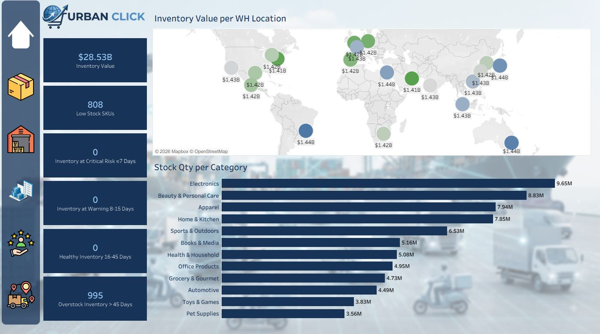
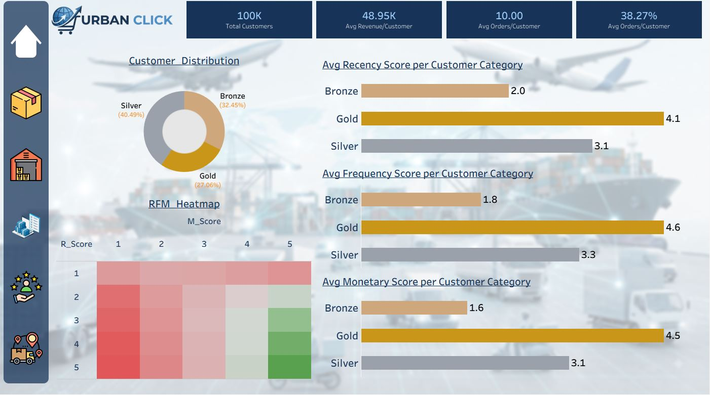
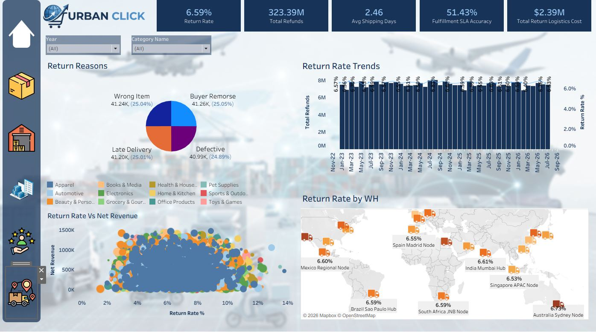
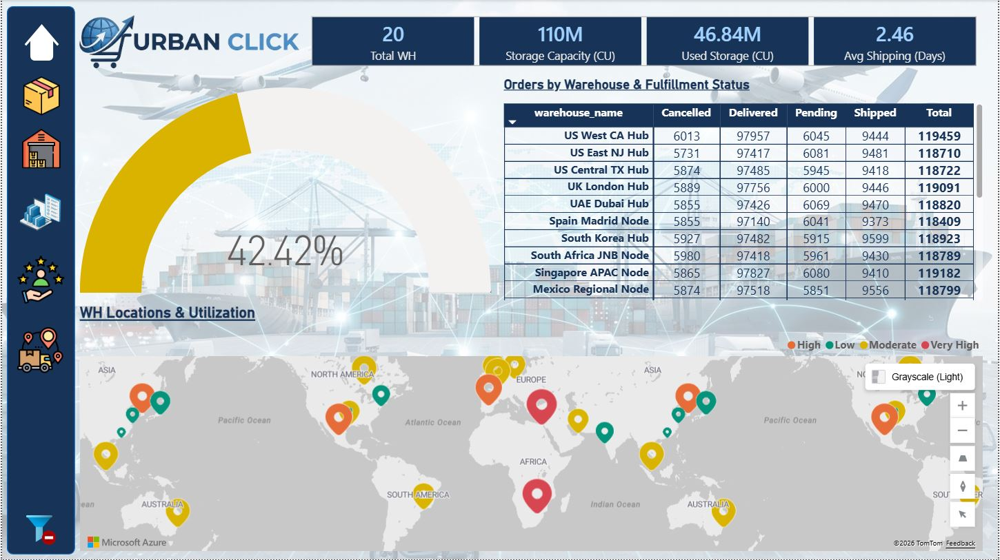
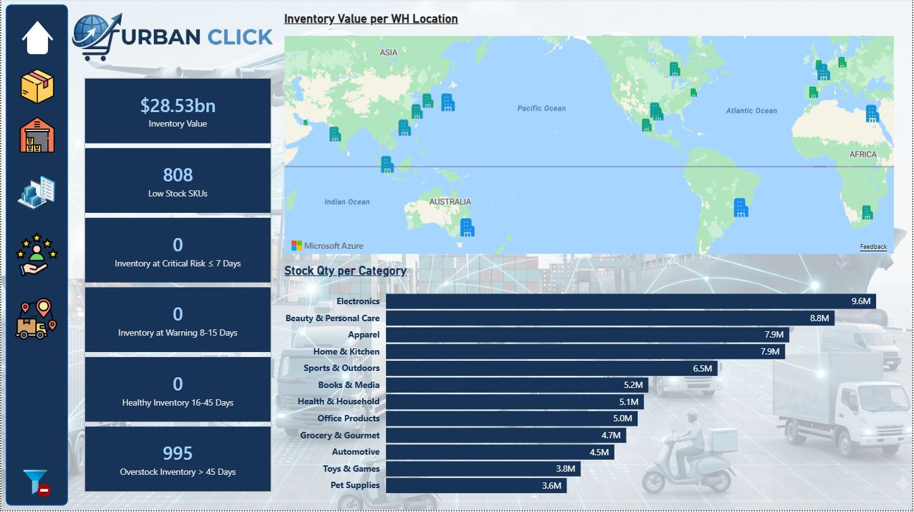
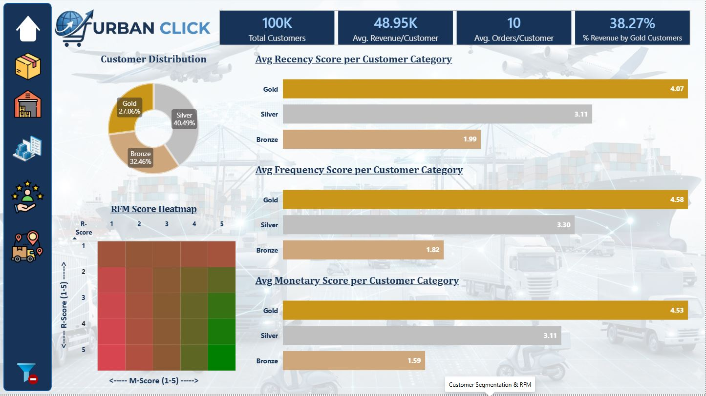
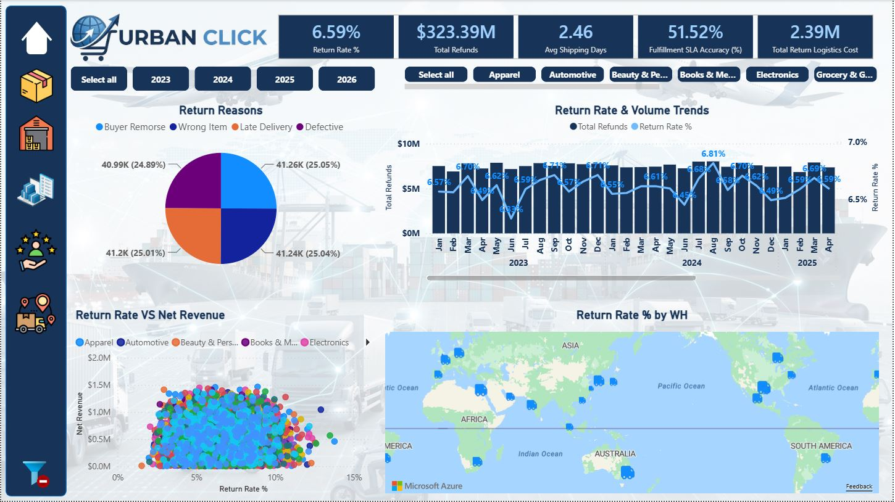

# Urbanclick Global Ecommerce Analysis
## Overview
This project is a production-style end-to-end data analysis that simulates a real enterprise Ecommerce business.

The Project Covers:
- Business Understanding & Schema Design
- Synthetic Dataset Generation
- Data Cleaning & Validation
- Exploratory Data Analysis (EDA)
- Business Analysis
- Star Schema Design
- Power BI Dashboard
- Tableau Dashboard
- Executive Business Report

## Project Phases
- Phase 1: Business Understanding & Schema Design ✅
- Phase 2: Synthetic Data Pipeline (Python) ✅
- Phase 3: Data Warehouse & MySQL Implementation ✅
- Phase 4: Exploratory Analytics in Tableau & Power BI: Executive Overview ✅
- Phase 5: Exploratory Analytics in Tableau & Power BI: Product Analysis ✅
- Phase 6: Exploratory Analytics in Tableau & Power BI: Warehouse Location & Capacity Utilization ✅
- Phase 7: Exploratory Analytics in Tableau & Power BI: Inventory & Supply Chain Health ✅
- Phase 8: Exploratory Analytics in Tableau & Power BI: Customer Segmentation & RFM ✅
- Phase 9: Exploratory Analytics in Tableau & Power BI: Retruns and Logistics ✅
- Phase 10: Enterprise Packaging & Git Commit Optimization ✅

## Repository Structure
```text
data_pipeline/
docs/
power_bi/
reports/
sql/
tableau/
venv/
```

## Technology Stack
- MySQL
- Power BI
- Tableau
- Python (Data Generation)
- Git
- GitHub

## Documentation
- Business Requirement Document (BRD)
- ER_Diagram
- Metrics Catalog

## Portfolio

### Tableau

[Tableau Public Dashboard](https://public.tableau.com/views/urbanclick_analytics_platform/NetProfit?\:language=en-US&\:sid=&\:redirect=auth&\:display_count=n&\:origin=viz_share_link)

#### Executive Dashboard
Objective: How is the business performing? What are the major trends, customer segments, categories and regions by Order Volume, Revenue & Profit?


#### Product Analysis
Objective: Which products and categories are profitable or unprofitable? What is the relationship between revenue and profit?


#### WH Utilization
Objective: Monitor fulfillment bottlenecks, regional workload distribution, and warehouse capacity thresholds.



#### Inventory & Supply Chain Helth
Objective: Prevent stockouts on fast-moving items while reducing holding costs on dead stock.



#### Customer Segmentation & RFM
 Objective: Group customers into strategic value tiers (Gold, Silver, Bronze) based on Recency, Frequency, and Monetary (RFM) behavior.



#### Returns & Logistics
Objective: End-to-end operational visibility into product return behaviors and reverse logistics overhead.



### Power BI

[Power BI Dashboard](https://app.powerbi.com/view?r=eyJrIjoiYjM4YjIwMTYtMjEzNy00NGFmLThjMmUtMTc5MDFiM2ZkMmI3IiwidCI6Ijk4NjNhOWJhLTczYTktNDZkZi04YzMzLTNkZDM3NTczNzk0ZSJ9)

#### Executive Dashboard
Objective:  How is the business performing? What are the major trends, customer segments, categories and regions by Order Volume, Revenue & Profit?


#### Product Analysis 
Objective:  Which products and categories are profitable or unprofitable? What is the relationship between revenue and profit?


#### WH Utilization
Objective: Monitor fulfillment bottlenecks, regional workload distribution, and warehouse capacity thresholds.



#### Inventory & Supply Chain Health
Objective: Prevent stockouts on fast-moving items while reducing holding costs on dead stock.



#### Customer Segmentation & RFM
Objective: Group customers into strategic value tiers (Gold, Silver, Bronze) based on Recency, Frequency, and Monetary (RFM) behavior.



#### Returns & Logistics
Objective: End-to-end operational visibility into product return behaviors and reverse logistics overhead.



